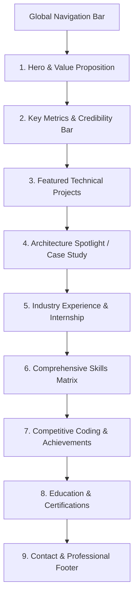

# Sri Harsha — Professional Engineering Portfolio Content Strategy & Blueprint

---

## 1. Executive Strategy & Positioning Architecture

### 1.1 Core Positioning
**Target Role:** Emerging AI/ML Engineer & Full-Stack Systems Developer  
**Unique Value Proposition (UVP):** Bridging the gap between mathematical machine learning / vision-language models and resilient, production-ready full-stack software architectures. Able to conceptualize models, integrate cutting-edge Generative AI APIs / open-source weights, build scalable backend services, and craft reactive frontend user interfaces.

### 1.2 Target Audience Segments & Engagement Objectives
1. **AI/ML Engineering Managers & Technical Leads:** Looking for demonstrated understanding of deep learning workflows, model evaluation, API orchestration, and clean code practices—not just toy notebook scripts.
2. **Full-Stack / Product Engineering Teams:** Looking for clean component architecture (React.js), robust API layers (Flask/Node.js), and database schema design (PostgreSQL/MySQL).
3. **Campus Recruiters & Talent Acquisition Specialists:** Looking for clear academic pedigree (B.Tech AI & ML, 8.51 CGPA at Lovely Professional University), proven competitive problem solving (LeetCode, HackerRank), verified certifications (Oracle AI Foundations), and internship experience.

---

## 2. Professional Identity & Headline Matrix

To give flexibility across portfolio sections, social platforms, and resume headers, the following tailored headlines are established:

* **Primary Portfolio Headline:**
  > **AI/ML Engineer & Full-Stack Developer**  
  > *Architecting intelligent vision-language systems and high-performance full-stack web applications.*

* **Alternative 1 (Technical & Systems-Focused):**
  > **Machine Learning Engineer & Software Developer**  
  > *Bridging deep learning, multimodal vision models, and robust end-to-end software engineering.*

* **Alternative 2 (Product & Impact-Focused):**
  > **Emerging AI Engineer & Full-Stack Builder**  
  > *Transforming complex algorithms and Generative AI into intuitive, production-grade digital experiences.*

* **Short Tagline / Hero Subtitle:**
  > B.Tech CSE (AI & ML) @ LPU • 8.51 CGPA • Building at the intersection of Deep Learning, Generative AI, and Scalable Web Architecture.

---

## 3. Hero Section Copywriting

### 3.1 Badge / Availability Pill
`● Open to AI/ML & Software Engineering Opportunities | Summer & Fall 2025/2026`

### 3.2 Main Heading (H1)
```text
Hi, I'm Sri Harsha.
I build intelligent AI systems and ship production-ready software.
```

### 3.3 Hero Narrative Paragraph
```text
I am a third-year Computer Science & Engineering undergraduate specializing in Artificial 
Intelligence and Machine Learning at Lovely Professional University (8.51 CGPA). My work 
spans multimodal vision-language intelligence, generative AI pipelines, and end-to-end 
full-stack application development. From building satellite image analysis assistants to 
interactive digital heritage platforms, I focus on transforming cutting-edge algorithms 
into reliable, user-centric software.
```

### 3.4 Primary & Secondary Call-to-Actions (CTAs)
* **Primary CTA:** `Explore Featured Work` *(Smooth scrolls to Projects section)*
* **Secondary CTA:** `Review Technical Skills & Resume` *(Triggers Resume preview modal / Direct download [Pending File Upload])*
* **Tertiary CTA / Connect:** `Get in Touch` *(Smooth scrolls to Contact section)*

---

## 4. Polished "About Me" Section Variants

### Variant A: Standard Multi-Paragraph (Recommended for Main Portfolio Page)
```text
I am an aspiring AI/ML Engineer and Full-Stack Software Developer currently in my third year of 
B.Tech in Computer Science and Engineering (AI & ML) at Lovely Professional University, holding a 
CGPA of 8.51.

My engineering journey is defined by a deep curiosity for how data-driven models interact with 
real-world software systems. Rather than viewing machine learning in isolation inside isolated 
notebooks, I treat models as core engines within broader software architectures. My practical 
work includes developing SatQuery AI—an interactive vision-language assistant for remote sensing 
analysis—along with full-stack intelligent systems like ResumeMatch AI and 3D Bharat.

Beyond building applications, I invest consistently in core computer science fundamentals. I have 
solved over 100 LeetCode problems, hold 4-star problem-solving badges across multiple languages on 
HackerRank, and actively compete in hackathons. During my internship as an AI/ML Intern at Edufiy 
Tech Solutions, I applied these competencies to production workflows.

I am driven by a commitment to clean code, modular architecture, and continuous technical growth, 
eager to contribute to forward-thinking engineering teams solving high-impact problems.
```

### Variant B: Concise / Fast-Scan (For Mobile or Sidebar Bio)
```text
Sri Harsha is an emerging AI/ML Engineer and Full-Stack Developer pursuing a B.Tech in CSE 
(AI & ML) at Lovely Professional University (8.51 CGPA). He combines applied deep learning and 
generative AI with robust full-stack engineering in React, Flask, and Node.js. With practical 
experience from Edufiy Tech Solutions, 100+ LeetCode algorithmic solutions, and competitive 
hackathon rankings, Harsha specializes in taking intelligent systems from mathematical design 
to deployed software.
```

### Variant C: Technical Story-Driven (For an in-depth "My Philosophy" or "Background" Sub-page)
```text
Software engineering is at an inflection point where intelligence is no longer an external add-on 
but an intrinsic architectural layer. My goal as an engineer is to bridge the gap between 
theoretical machine learning and production reliability.

In my academic tenure at Lovely Professional University, I have maintained an 8.51 CGPA while 
diverting substantial hours into self-directed system architecture. When building SatQuery AI, 
I tackled the complexities of multimodal remote sensing data, orchestrating vision and language 
pipelines to extract semantic meaning from overhead imagery. When creating 3D Bharat, I pivoted 
to rich frontend rendering and digital preservation, ensuring performant user experiences.

I complement high-level system design with rigorous data structures and algorithms practice, 
evidenced by 100+ LeetCode algorithmic milestones and top-bracket finishes in hackathons like 
CODE STORM. I write modular code, value automated testing, and design systems with maintenance 
and scalability in mind.
```

---

## 5. Professional Career Objective

```text
To secure an impactful AI/ML Engineering or Full-Stack Software Development role within an 
innovative engineering organization where I can leverage my expertise in multimodal deep learning, 
natural language processing, and modern web architectures. I aim to architect scalable machine 
learning pipelines, build robust user-facing applications, and contribute to high-velocity, 
agile software teams solving complex, real-world computational challenges.
```

---

## 6. Information Architecture & Content Hierarchy



### Section Breakdown & Strategic Purpose:

1. **Global Navigation Bar:**
   - Brand logo / Monogram (`SH`)
   - Links: `About`, `Projects`, `Experience`, `Skills`, `Achievements`, `Contact`
   - Actions: `Resume (PDF)` button, `Theme Switcher (Dark/Light)`

2. **Hero & Value Proposition Section:**
   - Visual focus: Clean typography, interactive badge, subtle terminal or mathematical graphic accent.
   - Core headline, brief narrative bio, and primary CTAs.

3. **Key Metrics & Credibility Bar:**
   - `8.51` CGPA (Academic Excellence)
   - `100+` Algorithmic Problems Solved (LeetCode)
   - `4+` Multi-Domain Intelligent Projects
   - `Oracle Certified` AI Foundations Associate

4. **Featured Technical Projects:**
   - Filter tabs: `All`, `AI & Machine Learning`, `Computer Vision & Multimodal`, `Full-Stack Systems`.
   - Card layout with clear visual badges: `Status: Deployed` vs `Status: Under Active Development`.
   - Features, architecture summary, tech stack tags, and action buttons (`Live Demo`, `Technical Case Study`).

5. **Architecture Spotlight / Case Study (Deep-Dive Component):**
   - Interactive breakdown of SatQuery AI or ResumeMatch AI displaying system dataflow (Input -> Preprocessing -> Model Inference -> API Layer -> Client View).
   - Demonstrates senior engineering documentation standards.

6. **Industry Experience Section:**
   - Role: AI/ML Intern @ Edufiy Tech Solutions (Jan 2025 – Mar 2025).
   - Highlights problem statements, solutions developed, and technologies utilized.

7. **Categorized Skills Matrix:**
   - Grouped into 8 clear functional domains (ML/DL, GenAI, Frontend, Backend, Databases, DevOps/Cloud, CS Fundamentals, Analytics).
   - Clear proficiency level tiering to ensure transparency and integrity.

8. **Competitive Coding & Hackathon Achievements:**
   - LeetCode milestone highlight.
   - HackerRank badges & contest rankings.
   - CODE STORM Hackathon recognition.

9. **Education & Verified Certifications:**
   - B.Tech CSE (AI & ML) at Lovely Professional University.
   - Oracle, React.js, and Front End Development credentials.

10. **Contact & Professional Footer:**
    - Direct contact inquiry form or email button.
    - Verified external profiles (GitHub, LinkedIn, LeetCode, HackerRank).
    - Copyright and content version note.

---

## 7. Scalable Content Strategy for Future Projects

To ensure the portfolio remains maintainable and scales seamlessly as Sri Harsha develops new projects in his third/fourth year, the following taxonomy and schema must be applied:

### 7.1 Project Taxonomy & Category Schema
Every project must be tagged with at least one Primary Category and up to three Secondary Tags:
* **Primary Categories:**
  * `AI/ML & Deep Learning` (Models, inference pipelines, custom datasets)
  * `Generative AI & LLMs` (RAG, agent workflows, LLM orchestration)
  * `Computer Vision` (Object detection, segmentation, image processing)
  * `Full-Stack Applications` (End-to-end architectures, CRUD, state management)
* **Status Badges (Mandatory for honesty):**
  * `Deployed (Live)` — Publicly accessible production URL.
  * `Prototype (In Development)` — Functional local codebase; production deployment pending.
  * `Research / Experimental` — Feasibility study, algorithmic benchmark, or paper implementation.

### 7.2 Scalability Rules
1. **Tier 1 (Featured - Max 3 to 4):** Prominently displayed with comprehensive system architecture diagrams, problem-solution narrative, and live links.
2. **Tier 2 (Secondary Projects - Grid of Cards):** Compact cards showing core summary, tech badges, and source/demo links.
3. **Tier 3 (Archived / Academic Exercises):** Searchable or expandable list to prevent visual clutter while preserving depth.

---

## 8. Micro-Copy, Navigation & Call-to-Action Specifications

* **Resume Button Tooltip:** "View verified academic and technical credentials (PDF)"
* **Project Status Tooltips:**
  * *Deployed:* "Production deployment live on verified hosting environment"
  * *Under Development:* "Core pipeline implemented; interface & deployment in active progress"
* **Copy Email Action:** "Click to copy email address to clipboard" -> Toast: "Email copied successfully!"
* **Footer Disclaimer:** "Engineered with modern web standards. Content verified and maintained by Sri Harsha."
