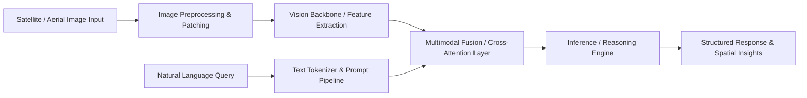
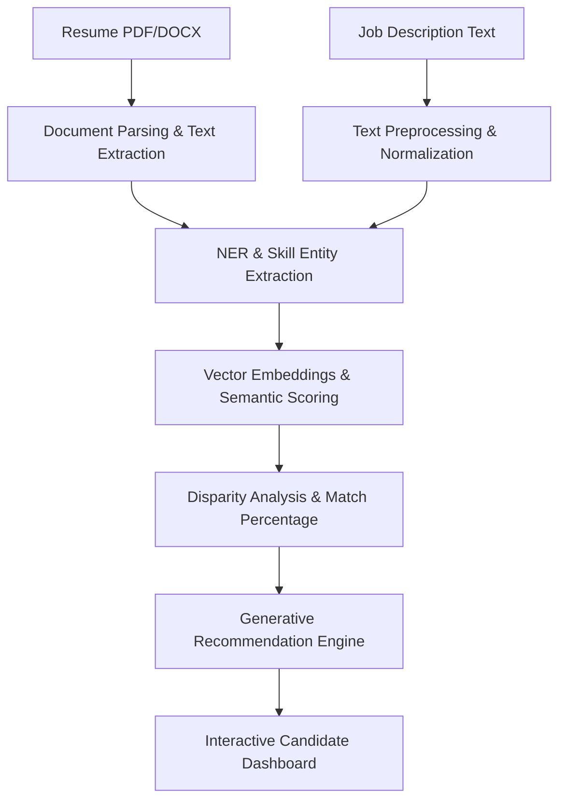
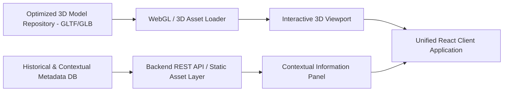

# Comprehensive Project Documentation & Technical Architecture Specifications

This document outlines the detailed case studies for all current projects in Sri Harsha's engineering portfolio, establishes a rigorous differentiation between **Implemented** and **Planned** capabilities, and provides a production-grade template for future project additions.

---

## Standard Project Documentation Template

Every project in the portfolio follows this standardized architectural structure:
1. **Header Metadata:** Project Name, Subtitle, Category, Status, Primary Link, Timeline.
2. **Executive Summary:** High-level problem statement and engineering solution.
3. **Core Architecture & Dataflow:** Pipeline description and Mermaid diagram.
4. **Key Features & Capabilities:** Grouped strictly by Implementation Status (*Implemented* vs. *Planned/Roadmap*).
5. **Technical Stack Breakdown:** Categorized by layer (Model/AI, Backend, Frontend, Storage, Cloud/DevOps).
6. **Engineering Challenges & Tradeoffs:** Real-world problem-solving details.
7. **Verification & Missing Information Notes:** Action items needed from Sri Harsha.

---

## Project 1: SatQuery AI

### 1.1 Metadata
* **Title:** SatQuery AI
* **Subtitle:** Interactive Vision-Language Assistant for Multimodal Remote Sensing Image Analysis
* **Category:** Multimodal AI / Computer Vision / Remote Sensing
* **Status:** In Active Development / Prototype
* **Primary Link:** `[Deployment URL Pending Verification - e.g., Render/HuggingFace Spaces]`
* **Code Repository Reference:** `[Private / Staged in Source Control]`

### 1.2 Executive Overview
Remote sensing imagery (satellite and aerial observations) presents unique computational challenges: high spectral variability, dense spatial patterns, and multi-scale geographic features that generic vision models fail to interpret accurately. 

**SatQuery AI** is an interactive vision-language assistant designed to ingest overhead imagery and allow domain practitioners, urban planners, and environmental researchers to query geographic visual data using natural language prompts. The system bridges multimodal embedding spaces with domain-tuned language models to interpret land cover patterns, infrastructure density, and structural anomalies.

### 1.3 System Architecture & Dataflow


### 1.4 Feature Breakdown

#### Implemented Features:
* **Multimodal Input Ingestion:** Accepts remote sensing imagery (high-resolution raster images) alongside user-defined conversational queries.
* **Vision-Language Alignment:** Interprets visual terrain features (vegetation, water bodies, built-up urban infrastructure) in context with domain-specific text inquiries.
* **Interactive Query Response Pipeline:** Formulates descriptive analysis regarding observed visual features, geographic object presence, and land-use categorization.
* **Pre-inference Preprocessing:** Image normalization and resizing optimized for dense visual representations.

#### Planned Features (On Roadmap):
* **Bounding Box Grounding & Spatial Highlighting:** Visual overlay of coordinates highlighting queried entities (e.g., specific roads, industrial zones, water reservoirs) directly on the satellite tile.
* **Temporal Change Detection:** Uploading two multi-temporal scenes of the same region to automatically compute and summarize environmental or infrastructural changes.
* **Fine-Tuned Domain Adapters (LoRA):** Training lightweight adapters on remote sensing benchmarks (e.g., RSVQA, LandCoverNet) to elevate factual accuracy.

### 1.5 Technology Stack
* **AI & Vision-Language Models:** Multimodal LLMs / Vision Backbones (OpenAI Vision API / Gemini API / Hugging Face Transformers).
* **Backend Framework:** Python, Flask / FastAPI for serving inference requests.
* **Image Processing:** OpenCV, PIL, NumPy.
* **Frontend Interface:** React.js for image upload, conversational chat interface, and result rendering.
* **Hosting / Environment:** Target: Render / Vercel.

### 1.6 Engineering Challenges & Tradeoffs
* **Challenge:** Generic vision-language models struggle with top-down nadir perspectives compared to standard horizontal photographic images.
* **Engineering Tradeoff:** Balancing prompt-guided zero-shot reasoning using high-capacity LLM APIs versus local parameter-efficient fine-tuning (PEFT), weighing inference latency against geographic domain specificity.

---

## Project 2: ResumeMatch AI

### 2.1 Metadata
* **Title:** ResumeMatch AI
* **Subtitle:** Intelligent Resume-Job Description Alignment & Career Telemetry Platform
* **Category:** Applied NLP / Generative AI / Full-Stack Systems
* **Status:** Functional Core Implemented / Advanced Modules in Development
* **Primary Link:** `[Deployment URL Pending Verification]`
* **Code Repository Reference:** `[Staged in Source Control]`

### 2.2 Executive Overview
Navigating algorithmic Applicant Tracking Systems (ATS) and tailoring applications across varied engineering disciplines is a manual, inefficient process. 

**ResumeMatch AI** is an intelligent candidate telemetry platform that parses complex resume documents (PDF/DOCX), extracts semantic entity representations (technical skills, project scopes, experience levels), and evaluates semantic similarity against job descriptions. It outputs match scores, keyword disparity matrices, and actionable generative recommendations to improve alignment.

### 2.3 System Architecture & Dataflow


### 2.4 Feature Breakdown

#### Implemented Features:
* **Multi-Format Parsing:** Automated extraction of unstructured text and formatting from candidate resumes.
* **Semantic Skill & Keyword Extraction:** Identifies programming languages, frameworks, databases, and methodologies using NLP and pattern extraction.
* **Algorithmic Match Scoring:** Computes semantic and keyword-based overlap percentages between candidate profiles and job requirements.
* **Gap Analysis Matrix:** Generates an immediate visual breakdown of missing competencies and recommended resume modifications.
* **Interactive Web Dashboard:** Clean UI built in React.js for uploading resumes, pasting job descriptions, and viewing real-time telemetry.

#### Planned Features (On Active Development Roadmap):
* **Interview Intelligence Module:** Generating customized technical and behavioral interview preparation questions derived from identified candidate resume gaps.
* **Real-Time Dynamic Resume Tailoring:** Generative rephrasing suggestions for bullet points utilizing STAR (Situation, Task, Action, Result) methodology.
* **Authentication & History Storage:** User account creation with PostgreSQL/MySQL persistence to track historical application matches and score improvements.

### 2.5 Technology Stack
* **NLP & Generative AI:** Natural Language Processing (Scikit-learn, Hugging Face / OpenAI / Gemini API).
* **Backend & API:** Python (Flask), RESTful endpoints for document ingestion and telemetry generation.
* **Frontend:** React.js, HTML5, CSS3, modern UI components.
* **Database / Persistence:** PostgreSQL / MySQL *(Planned for user account sessions)*.
* **Deployment Platform:** Target: Vercel (Frontend), Render (Backend).

### 2.6 Engineering Challenges & Tradeoffs
* **Challenge:** Resumes have highly inconsistent typographic structures (multi-column tables, varied font encodings) that break standard sequential text scrapers.
* **Engineering Tradeoff:** Implemented robust preprocessing normalization layers before feeding extracted strings into embedding models to avoid token degradation and score distortion.

---

## Project 3: 3D Bharat

### 3.1 Metadata
* **Title:** 3D Bharat
* **Subtitle:** Interactive Digital Heritage Exploration & Preservation Platform
* **Category:** Interactive Web Applications / 3D Graphics / Cultural Heritage Tech
* **Status:** Functional Web Application
* **Primary Link:** `[Deployment URL Pending Verification]`
* **Code Repository Reference:** `[Staged in Source Control]`

### 3.2 Executive Overview
Historical monuments and archaeological landmarks in India represent invaluable cultural capital, yet access is often limited by geography and static 2D media. 

**3D Bharat** is an immersive digital heritage exploration platform built to democratize access to Indian architectural landmarks. The platform combines interactive 3D model visualization with curated historical, architectural, and geographic contextual data, delivering an educational experience directly in the web browser without requiring dedicated spatial hardware.

### 3.3 System Architecture & Dataflow


### 3.4 Feature Breakdown

#### Implemented Features:
* **Interactive 3D Model Rendering:** Real-time orbit, zoom, and pan controls allowing full 360-degree inspection of landmark geometry.
* **Architectural Annotations:** Interactive spatial markers on 3D models displaying historical facts, architectural styles, and structural details upon selection.
* **Responsive Web Experience:** Seamless rendering across desktop and mobile screens with optimized canvas scaling.
* **Curated Heritage Catalog:** Categorized directory of Indian heritage sites with high-resolution imagery and verified historical documentation.

#### Planned Features (On Roadmap):
* **WebXR / VR Mode:** Native virtual reality viewing directly in supported web browsers.
* **AI Heritage Guide:** Conversational agent embedded within the 3D viewport answering questions regarding the monument's historical context in real time.

### 3.5 Technology Stack
* **Frontend:** React.js, WebGL / 3D rendering library (Three.js / React Three Fiber / Model Viewer), HTML5 Canvas, Modern CSS.
* **Backend:** Node.js / Flask for serving site metadata and handling dynamic asset delivery.
* **Asset Optimization:** GLTF/GLB 3D asset compression for rapid client-side loading.
* **Deployment:** Target: Vercel / Netlify.

### 3.6 Engineering Challenges & Tradeoffs
* **Challenge:** High-polygon 3D meshes cause severe framerate drops and excessive memory usage on client devices with limited GPU acceleration.
* **Engineering Tradeoff:** Implementing mesh decimation and compressed GLTF binary formats to maintain high visual fidelity while keeping payload sizes under 5MB per asset.

---

## Project 4: MoodMate

### 4.1 Metadata
* **Title:** MoodMate
* **Subtitle:** Real-Time Facial Expression Recognition & Contextual Music Recommendation Engine
* **Category:** Computer Vision / Affective Computing / Recommendation Systems
* **Status:** Functional Core Prototype
* **Primary Link:** `[Deployment URL Pending Verification]`
* **Code Repository Reference:** `[Staged in Source Control]`

### 4.2 Executive Overview
Traditional music recommendation algorithms rely almost exclusively on historical listening habits and explicit user searching, ignoring the user's real-time emotional state.

**MoodMate** is an affective computing application that analyzes live video frames from a web camera, detects user facial micro-expressions, classifies the dominant emotional state using deep convolutional networks, and dynamically generates a personalized music playlist corresponding to or elevating that emotion.

### 4.3 System Architecture & Dataflow


### 4.4 Feature Breakdown

#### Implemented Features:
* **Real-Time Face Detection & Bounding:** Streams client webcam video, isolates the face bounding box, and crops the region of interest (ROI) in real-time.
* **Facial Emotion Classification:** Deep neural network (Keras/TensorFlow) trained to categorize facial features into discrete emotion categories (e.g., Happy, Sad, Neutral, Surprised, Stressed).
* **Automated Playlist Mapping:** Rule-based and mood-matrix driven algorithm that maps recognized emotion states to curated music recommendations.
* **Interactive Player UI:** Visual interface displaying live camera feed, emotion prediction confidence metrics, and embedded audio controls.

#### Planned Features (On Roadmap):
* **Spotify Web API Integration:** Live OAuth authentication connecting directly to a user's personal Spotify account for automated library curation.
* **Multi-Modal Emotion Ingestion:** Combining facial landmark dynamics with voice acoustic tone analysis for elevated emotional prediction fidelity.

### 4.5 Technology Stack
* **Deep Learning & Computer Vision:** TensorFlow, Keras, OpenCV, Scikit-learn.
* **Backend:** Python (Flask), streaming endpoints for frame classification.
* **Frontend:** HTML5, CSS3, JavaScript / React.js.
* **Audio Integration:** Web Audio API / Spotify API integration layer *(Planned)*.

### 4.6 Engineering Challenges & Tradeoffs
* **Challenge:** Low ambient lighting and extreme head pose variations frequently cause false emotion classifications or dropped face detection frames.
* **Engineering Tradeoff:** Utilized histogram equalization and confidence-threshold filtering to prevent erratic playlist switching on momentary micro-expressions.

---

## Project 5: TrafficShield

### 5.1 Metadata
* **Title:** TrafficShield
* **Subtitle:** Intelligent Traffic Monitoring & Violation Detection System *(Provisional)*
* **Category:** Computer Vision / Intelligent Transportation Systems / Edge AI
* **Status:** Technical Specification & Scoping Phase *(Details Pending Confirmation)*
* **Primary Link:** `[Deployment URL Pending Verification]`
* **Code Repository Reference:** `[Pending Confirmation]`

### 5.2 Preliminary Overview & Hypothesis
*(Pending confirmation from Sri Harsha)*: Based on standard computer vision transportation safety implementations, TrafficShield represents an intelligent traffic monitoring framework engineered to detect vehicular violations, analyze roadway density, or ensure helmet/seatbelt compliance using automated computer vision pipelines.

### 5.3 Technical Verification Gaps (Required Input from Sri Harsha):
* **Core Problem Statement:** Is TrafficShield focused on traffic congestion telemetry, helmet/seatbelt non-compliance detection, signal violation tracking, or accident alert systems?
* **Model Architecture:** Was object detection implemented via YOLO (v5/v8), Faster R-CNN, or standard OpenCV background subtraction?
* **Dataset Used:** Custom video surveillance footage, Kaggle traffic datasets, or Indian road condition benchmarks?
* **Current Implementation State:** Completed command-line script, standalone GUI, or full web dashboard?

---

## Project 6: Future Project Ingestion Template

When Sri Harsha introduces new engineering projects to the portfolio, the following standardized schema must be populated before publishing:

```markdown
### Project Name: [Project Title]
* **Subtitle:** [One-line technical description highlighting core innovation]
* **Category:** [AI/ML | Generative AI | Computer Vision | Full-Stack | Cloud Systems]
* **Status:** [Deployed (Live) | Functional Prototype | In Active Development]
* **Primary Link:** [Live Deployed Application URL - e.g. Vercel, Render, AWS]
* **Code Repository:** [GitHub Repository URL / "Internal / Private Repository"]

#### 1. Problem Statement & Impact
* What real-world computational or business problem does this project address?
* Why does existing software or manual practice fall short?

#### 2. Technical Architecture & Dataflow
* Visual Mermaid diagram mapping the flow from client input through APIs and models to database and output.
* Brief narrative describing key architectural decisions.

#### 3. Feature Breakdown
* **Implemented Features:** [Explicit list of features that are 100% functional today]
* **Planned Roadmap Features:** [Features currently planned or under active design]

#### 4. Complete Technology Stack
* **Core Languages:** [e.g., Python, TypeScript, Java]
* **Machine Learning / AI:** [e.g., PyTorch, TensorFlow, Hugging Face, Gemini API]
* **Backend Frameworks:** [e.g., FastAPI, Flask, Node.js]
* **Frontend Frameworks:** [e.g., React.js, Tailwind CSS]
* **Databases & Caching:** [e.g., PostgreSQL, Redis, MongoDB]
* **Cloud & DevOps:** [e.g., Docker, GitHub Actions, Vercel, Render]

#### 5. Engineering Challenges & Measurable Metrics
* Detail one significant technical hurdle encountered and how it was resolved.
* Concrete metrics: (e.g., latency reduction, inference speed, accuracy/F1 score, lighthouse score).
```
