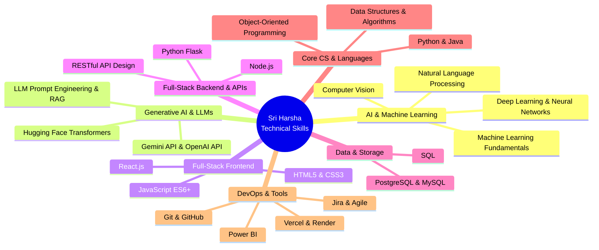

# Technical Skills Matrix & Competency Framework

This document organizes Sri Harsha's technical proficiencies into structured categories, defines transparent proficiency tiers based on real-world application, and links each competency to tangible project and coursework evidence.

---

## 1. Proficiency Tier Definitions

To avoid resume inflation and ensure maximum credibility with senior technical interviewers, skills are classified into three distinct tiers:

* **Tier 1: Proficient / Production & Project Applied (Core Stack)**
  Technologies extensively implemented in completed projects, competitive programming, or professional internship workflows. Capable of building and debugging end-to-end features independently.
* **Tier 2: Working Knowledge / Intermediate**
  Technologies utilized in academic coursework, functional prototypes, or structured projects. Solid conceptual understanding with ability to execute tasks with standard documentation reference.
* **Tier 3: Familiar / Emerging & Tooling Integration**
  APIs, foundation models, and development tooling actively leveraged, experimented with, or integrated into broader architectures.

---

## 2. Categorized Skills Architecture

---

## 3. Detailed Competency Breakdown

### 3.1 Artificial Intelligence & Deep Learning
| Technology / Skill | Proficiency Tier | Evidence & Application |
| :--- | :--- | :--- |
| **Machine Learning** | Proficient | Scikit-learn algorithms, feature engineering, classification & regression models (ResumeMatch AI, Edufiy Tech Solutions). |
| **Deep Learning** | Working Knowledge | Neural network design, loss functions, activation functions, backpropagation (B.Tech AI & ML specialization). |
| **TensorFlow & Keras** | Working Knowledge | Convolutional Neural Networks (CNNs), emotion recognition model training and inference (MoodMate). |
| **Computer Vision (OpenCV)** | Proficient | Real-time frame processing, face detection (Haar Cascade), image normalization, ROI extraction (MoodMate, SatQuery AI). |
| **Natural Language Processing (NLP)** | Working Knowledge | Text tokenization, TF-IDF vectorization, semantic similarity scoring, named entity extraction (ResumeMatch AI). |

### 3.2 Generative AI & Large Language Models (LLMs)
| Technology / Skill | Proficiency Tier | Evidence & Application |
| :--- | :--- | :--- |
| **OpenAI API & Gemini API** | Proficient | API orchestration, multimodal vision-language prompt pipelines, structured JSON outputs (SatQuery AI, ResumeMatch AI). |
| **Hugging Face** | Working Knowledge | Pre-trained model loading, tokenizers, transformer embeddings for semantic text matching. |
| **Claude & Anthropic API** | Familiar | Prompt engineering, long-context text analysis, evaluation comparisons. |
| **Multimodal Vision-Language** | Working Knowledge | Remote sensing scene interpretation, prompt-guided visual reasoning (SatQuery AI). |

### 3.3 Full-Stack Frontend Development
| Technology / Skill | Proficiency Tier | Evidence & Application |
| :--- | :--- | :--- |
| **React.js** | Proficient | Component-driven architecture, custom hooks, state management, asynchronous API integration (Certified by Tech Veda, 3D Bharat, ResumeMatch AI UI). |
| **JavaScript (ES6+)** | Proficient | Asynchronous programming (Promises, `async`/`await`), array transformations, DOM manipulation. |
| **HTML5 & Modern CSS3** | Proficient | Semantic web structuring, Flexbox, CSS Grid, mobile-responsive layouts (Certified by Great Learning). |

### 3.4 Full-Stack Backend & API Engineering
| Technology / Skill | Proficiency Tier | Evidence & Application |
| :--- | :--- | :--- |
| **Python (Flask)** | Proficient | Lightweight REST API construction, multipart document upload endpoints, model inference serving (ResumeMatch AI, SatQuery AI). |
| **Node.js** | Working Knowledge | Server-side runtime, basic API routing, asynchronous event handling. |
| **RESTful API Design** | Proficient | Clean endpoint contract design, status codes, JSON serialization, error handling. |

### 3.5 Databases & Data Management
| Technology / Skill | Proficiency Tier | Evidence & Application |
| :--- | :--- | :--- |
| **SQL** | Proficient | Complex querying, JOINs, indexing, grouping, schema normalization (Academic curriculum & Oracle Certification). |
| **PostgreSQL** | Working Knowledge | Relational schema modeling, candidate data persistence, structured telemetry storage. |
| **MySQL** | Working Knowledge | Relational database operations, transactions, user table management. |
| **Oracle AI Database Foundations**| Certified Knowledge | Certified Foundations Associate: Autonomous database concepts, AI within cloud data architectures. |

### 3.6 Core Computer Science & Programming Languages
| Technology / Skill | Proficiency Tier | Evidence & Application |
| :--- | :--- | :--- |
| **Python** | Proficient | Primary programming language for AI/ML, backend services, and algorithmic problem solving (HackerRank 4-Star). |
| **Java** | Proficient | Core Object-Oriented Programming, enterprise data structures, algorithmic implementations (HackerRank 4-Star). |
| **Data Structures & Algorithms (DSA)**| Proficient | 100+ LeetCode problems solved, HackerRank Problem Solving 4-Star, competitive hackathon optimization. |
| **Object-Oriented Programming (OOP)**| Proficient | Polymorphism, Inheritance, Encapsulation, Abstraction, SOLID principles applied across Java and Python. |

### 3.7 Cloud, DevOps & Development Tooling
| Technology / Skill | Proficiency Tier | Evidence & Application |
| :--- | :--- | :--- |
| **Git & GitHub** | Proficient | Version control, branch management, collaborative pull requests, merge conflict resolution. |
| **Vercel** | Proficient | Continuous deployment, automated frontend builds, environment variable configuration for React applications. |
| **Render** | Working Knowledge | Web service deployment for Python Flask backends and persistent background workers. |
| **Jira** | Working Knowledge | Agile issue tracking, sprint planning, user story estimation (Used during internship and academic projects). |
| **Power BI** | Working Knowledge | Data visualization, dashboard design, exploratory business intelligence reporting. |

---

## 4. Skills Visual Grouping for the Portfolio UI

When rendering the skills section on the frontend portfolio, present them in **6 curated interactive clusters** with visual icon tags:

1. **AI, Machine Learning & Vision:**
   `Python` • `TensorFlow` • `Keras` • `OpenCV` • `Scikit-learn` • `NLP` • `Computer Vision`
2. **Generative AI & LLMs:**
   `Gemini API` • `OpenAI API` • `Hugging Face` • `Claude` • `Prompt Engineering` • `Multimodal AI`
3. **Frontend Engineering:**
   `React.js` • `JavaScript (ES6+)` • `HTML5` • `CSS3` • `Responsive Design`
4. **Backend & Database Systems:**
   `Flask` • `Node.js` • `PostgreSQL` • `MySQL` • `SQL` • `REST APIs`
5. **Core Computer Science:**
   `Data Structures & Algorithms` • `Object-Oriented Programming` • `Java` • `Problem Solving`
6. **DevOps & Professional Tools:**
   `Git` • `GitHub` • `Vercel` • `Render` • `Jira` • `Power BI`
