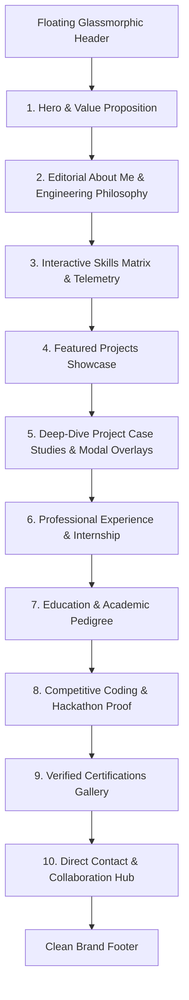

# UI/UX Experience Specification & Page Architecture

This document defines the user experience, interaction flows, information architecture, and accessibility standards for Sri Harsha's engineering portfolio.

---

## 1. Information Architecture & Master Page Flow

The portfolio is structured as a high-velocity single-page narrative with modular deep-dive overlays. This ensures hiring managers and recruiters can scan critical qualifications in under 45 seconds while allowing technical leads to inspect deep architectural case studies.

---

## 2. Section-by-Section UX Blueprint

### Section 1: Hero & Strategic Value Proposition
* **Visual Anchor:** Clean asymmetrical layout. Left side: High-contrast typography with interactive badge and clear CTAs. Right side: Interactive mathematical/multimodal telemetry card or dynamic code canvas representing vision-language dataflow.
* **Key Elements:**
  * Status Pill: `● Open to AI/ML & Software Engineering Roles` with a gentle emerald ping indicator.
  * H1 Headline: `Hi, I'm Sri Harsha. I build intelligent AI systems and ship production-ready software.`
  * Micro Narrative: 3 sentences summarizing academic standing (LPU, 8.51 CGPA), multimodal vision-language focus, and full-stack capabilities.
  * Action Cluster: `Explore Featured Work` (Primary Solid Blue Button) + `View Resume (PDF)` (Ghost Pill with Download Icon) + `Contact` (Subtle text link).
  * Quick Credibility Metrics Bar: 4 micro-stats (`8.51 CGPA`, `100+ LeetCode Solved`, `Oracle Certified`, `Top 16% Hackathon Finish`).

### Section 2: About Me (Editorial Split Narrative)
* **Layout Structure:** 2-column editorial magazine layout.
  * Left Column: Sticky portrait anchor with personal brand statement, current focus area, and quick metadata chips (Location: Punjab/India, Affiliation: Lovely Professional University, Specialization: AI & ML).
  * Right Column: Three distinct, readable story acts:
    1. *The Origin:* How theoretical curiosity in AI transitioned into hands-on full-stack development.
    2. *The Philosophy:* Why machine learning models are incomplete without resilient production software architectures.
    3. *The Discipline:* Continuous algorithmic training on LeetCode and collaborative sprint agility.

### Section 3: Technical Skills Matrix
* **Interactive Filtering:** Tab pills across top: `All Skills`, `AI & Machine Learning`, `Generative AI & LLMs`, `Full-Stack Frontend`, `Backend & APIs`, `Data & Cloud`.
* **Card Anatomy:** Each skill category is represented as a structured white card with hairline borders:
  * Category title with categorical icon.
  * Skill chips categorized by proficiency tier (Proficient vs. Working Knowledge).
  * Hovering over a skill displays a micro-tooltip referencing the project where it was applied (e.g., hovering `OpenCV` reveals *"Applied in MoodMate real-time facial recognition"*).

### Section 4: Featured Projects Showcase
* **Layout:** Generous alternating 2-column project cards (Desktop) and stacked cards (Mobile).
* **Card Anatomy:**
  * Visual Window: High-fidelity interface preview or system architecture diagram with subtle browser chrome wrapper.
  * Status Badge: `Deployed (Live)` in Emerald or `In Active Development` in Amber.
  * Project Title & Domain Category.
  * Two-sentence problem-and-solution summary.
  * Stack Tags: Pill badges highlighting 4 primary technologies.
  * Action Triggers:
    * `Launch Application` (External Link icon - only active if verified live URL exists).
    * `Read Case Study` (Triggers Section 5 deep-dive modal/drawer).

### Section 5: Project Case Studies (Deep-Dive Modal & Drawer System)
* **UX Mechanism:** Clicking `Read Case Study` on any project smoothly opens a non-disruptive, full-screen slide-over drawer or focused modal.
* **Modal Architecture:**
  * **Header:** Project title, live status, quick link triggers, and dismiss button (`Esc` key supported).
  * **Tab Navigation:** `Overview & Problem` | `System Architecture` | `Implemented vs. Planned` | `Engineering Hurdles`.
  * **Architecture Tab:** High-resolution interactive Mermaid dataflow diagram showing end-to-end data pipelines.
  * **Honesty Checklist:** Distinct visual split between features working today and future roadmap items.

### Section 6: Experience & Industry Internship
* **Layout:** Minimal vertical timeline with subtle continuous hairline rule and accent nodes.
* **Node Anatomy (AI/ML Intern @ Edufiy Tech Solutions):**
  * Date Pill: `Jan 2025 – Mar 2025` (JetBrains Mono).
  * Role & Organization: `AI/ML Intern` at `Edufiy Tech Solutions`.
  * Context & Summary: Overview of technical responsibilities.
  * Bullet Points: 3 clear action-oriented bullet points starting with strong engineering verbs (*Engineered*, *Optimized*, *Integrated*).
  * Technologies Utilized: Micro chips (`Python`, `Scikit-learn`, `Flask`, `Agile`).

### Section 7: Education & Academic Pedigree
* **Layout:** Clean credential card highlighting academic excellence.
* **Card Anatomy:**
  * University: `Lovely Professional University`.
  * Degree: `B.Tech in Computer Science and Engineering (AI & ML)`.
  * Status Badge: `Third Year Undergraduate`.
  * Metric Spotlight: Large high-contrast typography displaying `8.51` CGPA with a `High Academic Standing` subtext.
  * Coursework Tags: Core CS and specialized AI course chips.

### Section 8: Competitive Programming & Technical Achievements
* **Layout:** 3-column asymmetric stat cards.
  * **Card 1: LeetCode Milestone:**
    * Big Number: `100+`
    * Subtitle: Algorithmic Problems Solved.
    * Category Breakdown: Small visual progress bars for Data Structures, Two Pointers, Trees, and Dynamic Programming.
  * **Card 2: HackerRank Credentials:**
    * Contest Ranking: `Rank 1,716 / 3,062` in Orchestrate.
    * 4-Star Badges: Interactive star badges for `Problem Solving`, `Python`, `Java`, and `C++`.
  * **Card 3: CODE STORM Hackathon:**
    * Ranking: `8th Place / 50 Teams`.
    * Focus: Rapid prototyping and end-to-end delivery under competitive time constraints.

### Section 9: Verified Certifications Gallery
* **Layout:** 3-column structured grid.
* **Card Anatomy:**
  * Credential Name (e.g., `Oracle AI Database Certified Foundations Associate`).
  * Issuing Organization with clean badge icon (Oracle, Tech Veda, Great Learning).
  * Verified Skills Covered.
  * CTA Button: `Verify Credential` with external link icon (ready for credential ID).

### Section 10: Contact & Collaboration Hub
* **Layout:** Split layout.
  * Left: Editorial invitation to collaborate, discussing internship/full-time opportunities, mentorship, or technical partnerships.
  * Right:
    * Quick Copy-to-Clipboard Email Pill: Clicking copies email and presents a smooth confirmation toast.
    * Direct Message Form: Minimal, clean inputs (`Your Name`, `Work Email`, `Message`) with zero spam friction.
    * Verified Profiles Grid: Icons and direct links to GitHub, LinkedIn, LeetCode, and HackerRank.

---

## 3. Navigation UX & Sticky Header Architecture

* **Desktop View:**
  * Floating dynamic island centered at the top of the viewport.
  * Background: Frosted ultra-translucent white (`rgba(255, 255, 255, 0.85)`) with `backdrop-blur-md` and 1px border (`#E2E8F0`).
  * Navigation Links: Smooth scroll triggers with active scroll-spy indicator (underlined by an animated blue pill).
  * Right Action: `Resume PDF` download button with immediate accessibility.
* **Mobile View:**
  * Compact header with Monogram logo (`SH`) and accessible hamburger menu trigger (48x48px touch target).
  * Smooth full-viewport glassmorphic slide-over drawer with large, accessible touch links.

---

## 4. Accessibility & Inclusive Design Standards

* **Contrast Compliance:** Every text-to-background ratio is tested and guaranteed >= `4.5:1` for normal text and >= `3.0:1` for large text, adhering to **WCAG 2.1 Level AA**.
* **Keyboard Navigation:** Full tab order flow across all interactive elements (`Tab` and `Shift+Tab`).
* **Focus Indicator:** Custom 2px blue ring (`--blue-600`) with a 2px offset on all interactive buttons, links, inputs, and close triggers.
* **Screen Reader Optimization:** ARIA landmark regions (`<header role="banner">`, `<main>`, `<section aria-labelledby="...">`, `<footer role="contentinfo">`).
* **Target Size:** All touch targets on mobile viewports are engineered to a minimum of **44x44px**.

---

## 5. Loading, Skeleton & Optimistic UI States

* **Initial Page Load:** Zero layout shift (CLS = 0). Skeleton cards pre-rendered with subtle shimmer waves (`#F1F5F9` to `#E2E8F0`) before dynamic project assets resolve.
* **Image Assets:** Progressive image loading with blurred LQIP (Low Quality Image Placeholder) baseline.
* **Contact Form Submission:**
  * Idle: Clean blue button `Send Message`.
  * Loading: Button displays subtle spinner with text `Sending...` (disabled state prevents duplicate submissions).
  * Success: Transitions into emerald checkmark `Message Sent Successfully!`.
